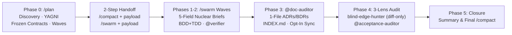

<p align="center">
  
</p>

<h1 align="center">Ignis Swarm (<code>ignis-swarm</code>)</h1>

<p align="center">
  <strong>Contract-driven, auditable <code>/swarm</code> engineering workflow for Google Antigravity.</strong><br/>
  Zero external dependencies · Tested in CI on Linux, Windows and macOS · Node.js &ge; 22
</p>

<p align="center">
  <a href="https://github.com/magalz/ignis-swarm/releases/tag/v1.1.0"></a>
  <a href="https://codecov.io/gh/magalz/ignis-swarm"></a>
  = 22" />
  
  <a href="LICENSE"></a>
  <a href="https://github.com/magalz/ignis-swarm/wiki"></a>
  <a href="https://agyswarm.magalz.space"></a>
</p>

---

## Why Ignis Swarm?

Most multi-agent setups rely on verbose personas and hope the model remembers every rule across long sessions. **`ignis-swarm`** enforces engineering rigor through **structural mechanisms** instead:

- **Frozen contracts before parallel fan-out** — `/plan` locks shared types, signatures, and exclusive file ownership before `/swarm` spawns parallel workers.
- **Outer-loop BDD + inner-loop TDD** — Every nuclear task starts with observable `Given / When / Then` criteria, proves a failing test first (Red → Green → Refactor), and forbids over-mocking and narrative inline comments.
- **Auditable decision trails** — Technical choices (`docs/adr/ADR-NNN-*.md`) and business rules (`docs/bdr/BDR-NNN-*.md`) live in 1 file per decision with a lean `INDEX.md`, enforced by a deterministic `Stop` hook.
- **Unbiased 3-lens final audit** — A `blind-edge-hunter` subagent (and optional headless Claude Opus / Codex CLI runners) reviews the change **from the diff alone**, without being given plans or trackers, paired with an independent `@acceptance-auditor`. The native subagent has only `grep_search`, `find_by_name` and a `run_command` limited to `git diff` over the given range and paths, and no file viewer. The headless runner is stricter: the diff arrives on stdin and Claude runs with `--tools ""`, `--setting-sources ""` and `--disable-slash-commands` (no tools, no user or project settings, no slash commands); the Codex invocation's flags (`--sandbox read-only`) have not been verified against every Codex release. The diff covers committed, staged, unstaged and untracked non-ignored changes (`collectChanges`); the native subagent's `git diff` does not show untracked files, so name them in its scope.
- **Resilient local MCP broker (`ignis-swarm_broker`)** — Supervises `stdio` and Streamable HTTP MCP servers behind 4 compact meta-tools with auto-reconnect, per-workspace pooling, local-first/global-fallback config, and spill-to-file output truncation.

---

## Prerequisites & Installation

- **Google Antigravity** (App or `agy` CLI)
- **Node.js `>= 22`** (powers the zero-dependency hooks and bundled MCP broker). CI runs Node 22 and 24 on Ubuntu and Windows, and Node 24 on macOS.

### Install via Antigravity CLI

```bash
# Install directly from GitHub
agy plugin install https://github.com/magalz/ignis-swarm

# Or install from a local clone
git clone https://github.com/magalz/ignis-swarm.git
agy plugin install ./ignis-swarm
```

### Verify Installation

```bash
agy plugin list
```

You should see `ignis-swarm (enabled, 1.1.0)` with **10 skills, 4 agents, 1 rule, 5 hooks, and 1 MCP server**. The four agents are `verifier`, `acceptance-auditor`, `doc-auditor` and `blind-edge-hunter`.

---

## First-Run Setup (`/ignis-onboarding`)

On your first interactive session in a project workspace, `ignis-swarm` prompts you to run **`/ignis-onboarding`** (you can also run it any time to reconfigure). Subagents and `/swarm` workers never receive onboarding prompts.

The wizard probes your environment (with secrets redacted) and configures 4 areas saved to `~/.ignis-broker/onboarding.json`:

1. **Managed MCP Servers** — Selectively register discovered MCP servers into `ignis-broker` without modifying your existing `~/.gemini/config/mcp_config.json`.
2. **Opt-In Issue Trackers** — Choose `None` (local repo only), **Linear**, **ItsAPlan**, and/or **GitHub Issues** for Phase 0 discovery and Phase 3 ADR/BDR mirroring.
3. **Opt-In Memtrace** — Optionally enable Memtrace code-intelligence health checks and broker integration (disabled by default).
4. **Phase 4 Blind Review Routing (`reviewRouting`)** — Before every question the wizard briefs you neutrally (what it is, what it does, why/trade-offs; no default labels). Q4 asks whether to use another model family (Claude Code CLI or Codex CLI) as blind reviewer; "No" saves `antigravity_gemini_only`. If "Yes", Q5 picks routing priority and Q6 picks the CLI backend (`claude` Opus / `codex` Sol) with an optional smoke test:
   - `antigravity_gemini_only` — Uses only the bundled Antigravity `blind-edge-hunter` subagent (zero external CLIs required).
   - `antigravity_first` — Uses `blind-edge-hunter` (Gemini Pro, not Claude Opus) first, falling back to a headless external CLI (`claude` Opus or `codex` Sol) if native quota runs out.
   - `headless_always` — Runs `scripts/run-blind-review.mjs` directly, falling back to native only if the external CLI fails (`fallbackToNative: true`). `PreToolUse` (`run_command|invoke_subagent`) blocks premature native `blind-edge-hunter` calls, and `SessionStart` injects `[ignis-swarm][Phase 4 Review Routing]` with the resolved script path.

> Deep dive into `onboarding.json` schema, CLI probing, and smoke tests: **[Getting Started & Onboarding](https://github.com/magalz/ignis-swarm/wiki/Getting-Started-and-Onboarding)**.

---

## Day-to-Day Commands & Skills

### 1. Primary Feature Workflow (Use Native Antigravity Commands)

`rules/AGENTS.md` automatically wires Antigravity's native commands to `ignis-swarm`:

| Step | Command you type | What happens |
| :--- | :--- | :--- |
| **1. Plan** | `/plan <feature or slice goal>` | Loads `ignis-plan` (Phase 0): targeted discovery, YAGNI gate, frozen contracts, atomic waves, BDD criteria, and `[ADR]`/`[BDR]` flags. |
| **2. Compact** | Run `/compact` via the slash menu with the pre-filled `Preserve: ...` payload *(from Phase 0)* | Compacts the conversation cleanly while keeping exact wave tasks, contracts, and file ownership. |
| **3. Execute** | Run `/swarm` via the slash menu with payload `Execute the approved plan starting at Wave 0/1 using ignis-swarm.` | Activates Antigravity's native Swarm runtime and loads `ignis-swarm` to dispatch waves, verify each task, write ADRs/BDRs, and run the 3-lens final audit. |

> [!IMPORTANT]
> **Handoffs are payload-only:** pasting text that starts with `/compact` or `/swarm` sends plain text and does not trigger the command; pick the command from the slash menu and paste only the payload.
>
> **Always use native `/swarm` (not `/ignis-swarm` alone) to run a swarm.**
> Antigravity only activates the native Swarm message board and `swarm` tool when you invoke `/swarm` explicitly. Once `/swarm` starts, `rules/AGENTS.md` automatically loads the `ignis-swarm` coordinator playbook.

### 2. Standalone On-Demand Playbooks

Call these directly whenever you don't need a full multi-wave slice:

| Command | When to use it |
| :--- | :--- |
| **`/ignis-onboarding`** | First-run setup or reconfiguring MCP broker servers, trackers, Memtrace, or `reviewRouting`. |
| **`/ignis-bug-fix`** | Standalone bugs or regressions: failing repro test first (Red), root-cause trace, `attack-the-premise` after 2 failed attempts, minimal fix, runtime proof. |
| **`/ignis-investigate`** | Read-only architectural questions or incident forensics (optionally parallelized), separating **Observed**, **Inferred**, and **Unknown** facts. |
| **`/ignis-benchmark`** | Methodological audit (*"Explain the Number"*) before trusting or reporting any latency, throughput, memory, or speedup claim. |

### 3. Stage Skills (Auto-Triggered & Usable Directly)

These skills trigger automatically during `/plan` and `/swarm`, and also work standalone when called directly:

| Command | Standalone use |
| :--- | :--- |
| **`/ignis-tdd-bdd`** | Implement a task with strict BDD + TDD, boundary-only mocking, and zero narrative inline comments. |
| **`/ignis-review`** | Run `@verifier` checks or the 3-lens final audit (`blind-edge-hunter` + `@acceptance-auditor`) on your current diff. |
| **`/ignis-audit-docs`** | Create/update `docs/adr/ADR-NNN-*.md`, `docs/bdr/BDR-NNN-*.md`, `INDEX.md`, and optional tracker links. |
| **`/ignis-broker`** | Query/call managed MCP servers via `ignis-swarm_broker` or troubleshoot the broker daemon. |
| **`/ignis-plan`** | Run Phase 0 planning rules directly outside Antigravity's native `/plan` UI mode. |

> Full reference with examples and trigger matrix: **[Commands & Skills Reference](https://github.com/magalz/ignis-swarm/wiki/Commands-and-Skills-Reference)**.

---

## The 5-Phase Workflow



1. **Phase 0 (`/plan`):** Maps callers/callees and `docs/{adr,bdr}/INDEX.md`, cuts dead weight (`subtract-before-you-add`) and speculative work (YAGNI), freezes shared contracts (Wave 0), and splits work into non-colliding waves with exclusive file ownership.
2. **Phases 1–2 (`/swarm` Coordinator + Workers):** Dispatches 1 named worker per nuclear task using a strict 5-field brief and capability-tier model routing; pairs waves with `@verifier` (Red → Green proof, scope check, anti-mock check, factual coverage) and pauses for `/compact` at wave boundaries when context pressure rises.
3. **Phase 3 (`@doc-auditor`):** Writes 1 file per `[ADR]`/`[BDR]` decision, updates `INDEX.md`, and optionally mirrors links/comments into your connected issue tracker.
4. **Phase 4 (3-Lens Final Audit):** Combines **`blind-edge-hunter`** (reviews the diff only: `grep_search`, `find_by_name` and `run_command` limited to `git diff`, no file viewer, `inheritMcp: false`, `model: pro`; or headless Claude/Codex via `scripts/run-blind-review.mjs`, which reads the committed, staged, unstaged and untracked non-ignored diff from stdin) with **`@acceptance-auditor`** (full access to plan, tracker, and ADRs/BDRs).
5. **Phase 5 (Closure):** Fixes proven `HIGH`/`MEDIUM` findings, reports observed coverage and audit verdicts, and emits a pre-filled post-slice `/compact` checkpoint.

> Detailed walkthrough, brief templates, model routing, and compaction checkpoints: **[Five-Phase Swarm Workflow](https://github.com/magalz/ignis-swarm/wiki/Five-Phase-Swarm-Workflow)**.

---

## Built-In Resilience & Safety at a Glance

### Resilient MCP Broker (`ignis-swarm_broker`)
Exposes **4 compact meta-tools** (`broker_list`, `broker_describe`, `broker_call`, `broker_status`) backed by a detached localhost Node.js daemon with lazy auto-start, crash recovery, per-workspace pooling, local-first (`.agents/ignis-broker.json`) + global-fallback (`~/.ignis-broker/servers.json`) config, `${VAR}` secret expansion from `~/.ignis-broker/.env` (global config only), and spill-to-file output truncation.

```bash
# Quick CLI diagnostics
node scripts/ignis-broker.mjs status
node scripts/ignis-broker.mjs discover-mcp
```

How the broker behaves:

- **Local configs need a git repo and your trust.** `.agents/ignis-broker.json` is found only inside a git repository, and is ignored until you review it and run `node scripts/ignis-broker.mjs trust --cwd <repo>`. Trust is bound to the file's exact bytes, so editing it voids trust. `trust --list` shows each entry as `trusted`, `changed` or `missing`. `${VAR}` is never expanded in a local config; keep secrets in the global `servers.json`. See [SECURITY.md](SECURITY.md) for the limits of this trust.
- **`import-mcp` merges** into `~/.ignis-broker/servers.json` and keeps servers registered earlier (a server with the same name is replaced). Literal env/header secrets move to `~/.ignis-broker/.env` as `IGNIS_<SERVER>_<KEY>`; the import is rejected if a generated variable name collides with another server's variable or a value contains a line break.
- **Working directory.** A stdio server without a `cwd` starts in the broker data directory (the daemon's working directory); a `perWorkspace` server without one starts in the workspace's repository root.
- **Lifecycle.** `stop` waits for the daemon and fails, naming its pid, if it survives. The daemon is started with `--data-dir <dir>`, and the broker hard-kills only a daemon that serves the same data dir. A daemon started by an older version has no `--data-dir`: it is asked to shut down, and if it ignores that, stop it by hand once. An explicit `restart` stops busy servers at once. A config change lets in-flight calls finish first. The daemon exits after `idleTimeoutSecs` (default 900) without traffic.
- **Errors mask known secrets.** In errors the broker returns, including fallback errors, expanded `${VAR}` values, header values, URL credentials and query values, and every stdio `env` value are replaced with `***` when they are 4 or more characters long. `import-mcp --dry-run`, `trust` and `onboarding --probe` print server configs with every `env` and header value as `***REDACTED***` and URLs without credentials or query; `discover-mcp` prints only server names and flags.

### Automatic Lifecycle Hooks (`hooks.json`)
| Hook | What it does automatically |
| :--- | :--- |
| **`SessionStart`** | Prompts first-run onboarding and injects `[ignis-swarm][Phase 4 Review Routing]` notice for `headless_always` / `antigravity_first` (main session only), detects `docs/{adr,bdr}/INDEX.md`, warns on local broker config errors/fallbacks, and checks opt-in Memtrace health. |
| **`PreToolUse`** (`run_command\|invoke_subagent`) | Enforces Phase 4 routing (blocks premature `blind-edge-hunter` under `headless_always`). Also blocks `--no-verify`, plain force-push to `main`/`master`, `git reset --hard`, and destructive root deletions; asks confirmation before other force pushes or `git clean -f`. |
| **`PostToolUse`** | Logs lightweight per-conversation JSONL audit entries (`~/.ignis-broker/audit/<id>.jsonl`) and tags test executions. |
| **`PostInvocation`** | Deterministic `compaction-watch.mjs` monitors active transcript size (default `550 KB`) and prompts a pre-filled `/compact` checkpoint. |
| **`Stop`** | Blocks finishing if any `ADR-NNN`/`BDR-NNN` file is missing from `INDEX.md` or if added git diff lines contain `.only`, `.skip`, `#[ignore]`, `t.Skip`, `@ts-ignore`, `eslint-disable`, bare `// nolint`, or new `TODO`/`FIXME`. |

---

## Full Documentation (GitHub Wiki)

Detailed guides, schemas, CLI flags, environment variables, and troubleshooting live in the **[GitHub Wiki](https://github.com/magalz/ignis-swarm/wiki)**:

| Wiki Page | What you'll find |
| :--- | :--- |
| **[Home](https://github.com/magalz/ignis-swarm/wiki)** | Documentation map by role and task |
| **[Getting Started & Onboarding](https://github.com/magalz/ignis-swarm/wiki/Getting-Started-and-Onboarding)** | Install methods, Q1–Q4 + Q5–Q6 wizard walkthrough, `onboarding.json` schema, CLI management |
| **[Commands & Skills Reference](https://github.com/magalz/ignis-swarm/wiki/Commands-and-Skills-Reference)** | All 10 skills, native `/plan` & `/swarm` rules, triggers, and standalone examples |
| **[Five-Phase Swarm Workflow](https://github.com/magalz/ignis-swarm/wiki/Five-Phase-Swarm-Workflow)** | Wave anatomy, 5-field nuclear brief, model routing tiers, compaction checkpoints |
| **[TDD/BDD & Audit Documentation](https://github.com/magalz/ignis-swarm/wiki/TDD-BDD-and-Audit-Documentation)** | BDD+TDD loop, anti-Goodhart rules, mutation testing, ADR/BDR templates, tracker profiles |
| **[Blind Review & Final Audit](https://github.com/magalz/ignis-swarm/wiki/Blind-Review-and-Final-Audit)** | `@verifier`, `blind-edge-hunter`, `run-blind-review.mjs` (Claude Opus & Codex Sol), `@acceptance-auditor` |
| **[Resilient MCP Broker](https://github.com/magalz/ignis-swarm/wiki/Resilient-MCP-Broker)** | Architecture, 4 meta-tools, all 14 CLI commands, config precedence, `.env` secrets, spill-to-file |
| **[Lifecycle Hooks & Guardrails](https://github.com/magalz/ignis-swarm/wiki/Lifecycle-Hooks-and-Guardrails)** | Exact rules for all 5 hooks, audit logs, and all environment variables |
| **[Architecture, Troubleshooting & FAQ](https://github.com/magalz/ignis-swarm/wiki/Architecture-Troubleshooting-and-FAQ)** | 8 engineering principles, ADR index, common issues & fixes, FAQ |

---

## Validation, Tests & Architecture Decisions

```bash
# Strict Antigravity plugin validation
agy plugin validate --strict .

# Full automated test suite (hooks, broker unit/supervisor/E2E, onboarding, blind-review runner)
node --test --test-timeout=180000 tests/*.test.mjs
```

- Architecture Decision Records: [docs/adr/INDEX.md](docs/adr/INDEX.md)
- Support & Issue Reporting: [agyswarm.magalz.space](https://agyswarm.magalz.space)
- Security Policy: [SECURITY.md](SECURITY.md) · Contributing: [CONTRIBUTING.md](CONTRIBUTING.md)

## License

[MIT](LICENSE) © 2026 [magalz](https://github.com/magalz)
